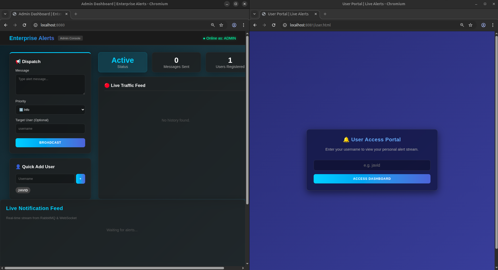
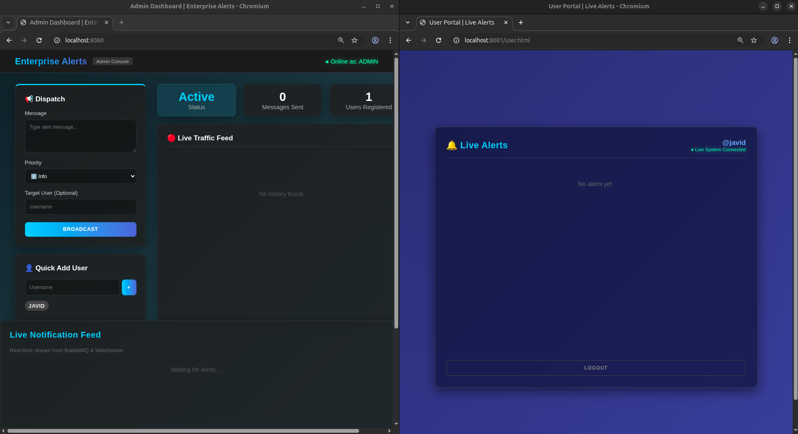
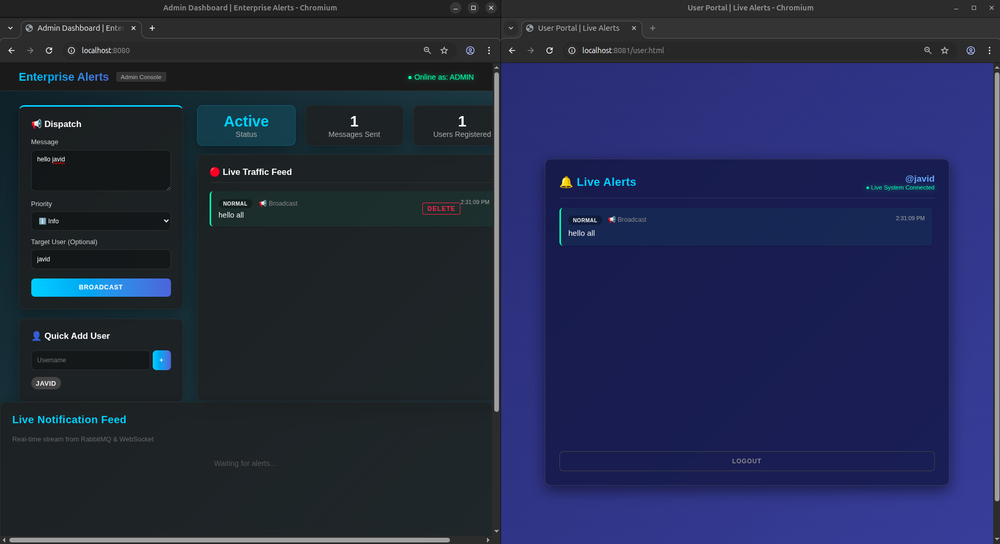
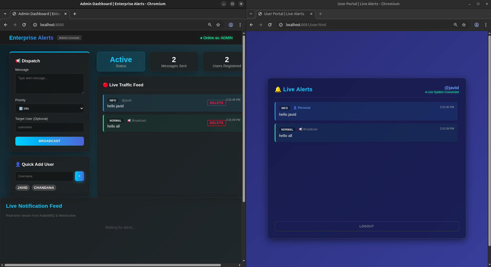
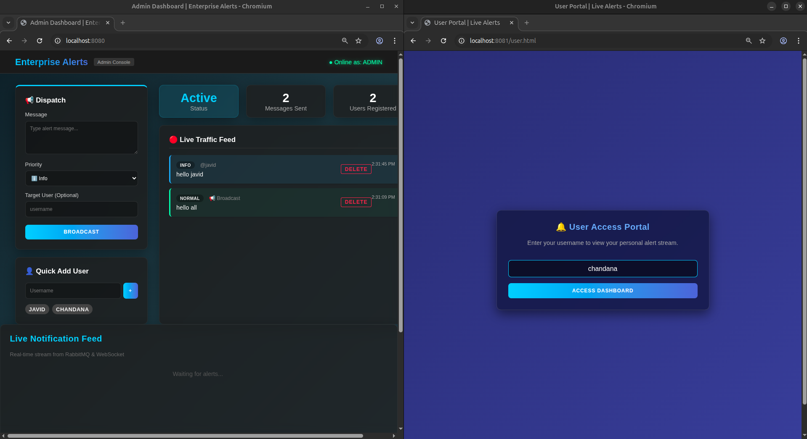
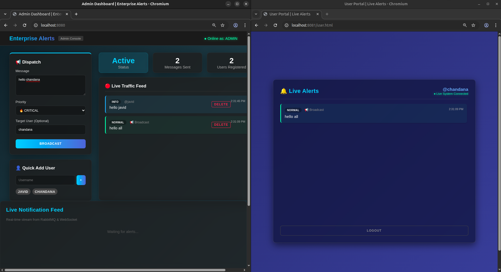
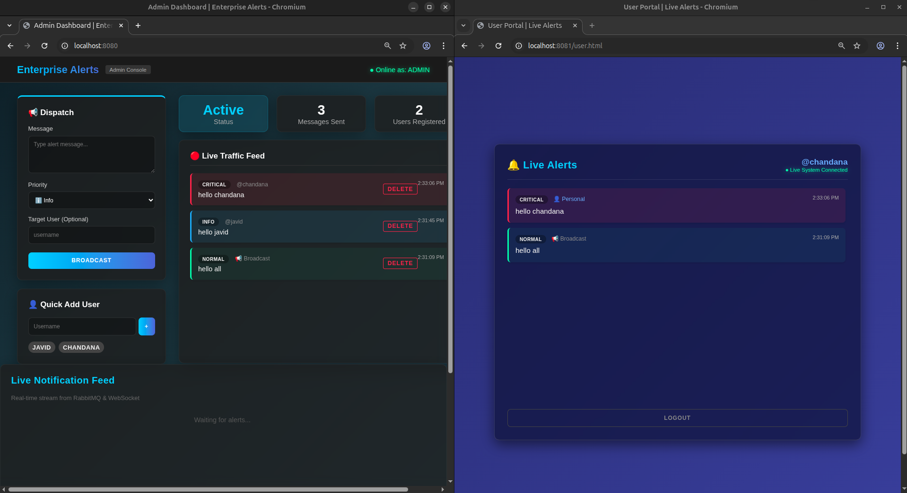
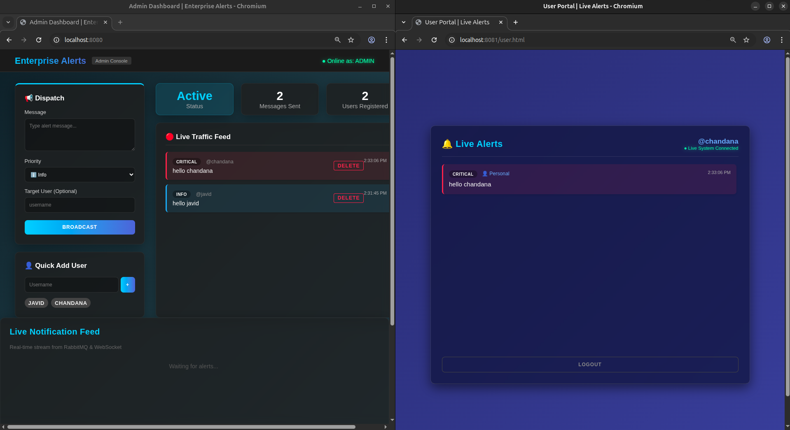
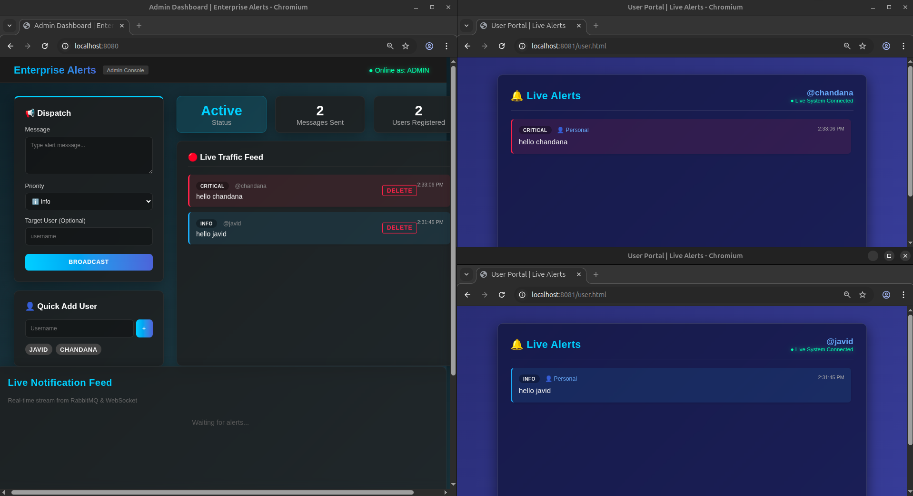
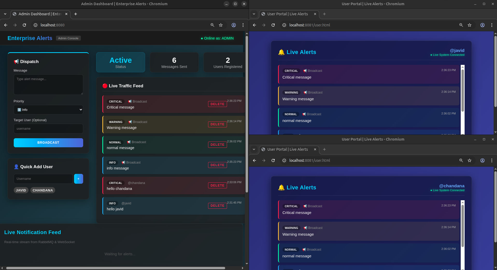

# Real-Time Notification & Alert System

A robust, enterprise-grade real-time notification system built with **Java Spring Boot**, **WebSockets**, **RabbitMQ**, and modern web technologies. This system efficiently delivers critical updates to users through both broadcast and targeted messaging, with features like rate limiting, priority queuing, and persistent storage.

---

## Features

### Core Functionality
- **Real-Time Messaging**: WebSocket-based instant notification delivery using STOMP protocol
- **Dual Delivery Modes**: 
  - **Broadcast**: Send alerts to all connected users
  - **Targeted**: Send personalized notifications to specific users
- **Priority Queue System**: HIGH, MEDIUM, LOW priority routing via RabbitMQ
- **Rate Limiting**: Prevents spam with configurable limits (5 messages/minute per user)
- **Message Deduplication**: Prevents duplicate notifications within a 60-second window
- **Persistent Storage**: All notifications stored in H2 database with full history

### Admin Dashboard
- **Live Statistics**: Real-time counts of users and notifications
- **Notification Management**: View complete history and delete old notifications
- **User Management**: Create and manage user accounts
- **Live Traffic Feed**: Monitor all notifications as they're sent
- **Modern UI**: Glassmorphism design with dark theme and animated gradients

### User Portal
- **Authentication**: Username-based login with validation
- **Notification History**: View all past notifications (personal + broadcasts)
- **Real-Time Updates**: Instant delivery of new notifications via WebSocket
- **Visual Distinction**: Clear indicators for personal vs. broadcast messages
- **Responsive Design**: Works seamlessly on desktop and mobile

---

## Architecture

```
┌─────────────┐      REST API       ┌──────────────────┐
│   Admin UI  │ ───────────────────>│  Spring Boot     │
│ (Port 8080) │                     │  Application     │
└─────────────┘                     │                  │
                                    │  - Controllers   │
┌─────────────┐    WebSocket        │  - Services      │
│  User Portal│ <──────────────────>│  - Repositories  │
│ (Port 8081) │      (STOMP)        │                  │
└─────────────┘                     └────────┬─────────┘
                                             │
                    ┌────────────────────────┼────────────────────┐
                    │                        │                    │
              ┌─────▼─────┐          ┌──────▼──────┐      ┌──────▼──────┐
              │ RabbitMQ  │          │ H2 Database │      │  WebSocket  │
              │  Queues   │          │  (In-Memory)│      │   Broker    │
              │           │          │             │      │             │
              │ - HIGH    │          │ - Users     │      │ - /topic/   │
              │ - MEDIUM  │          │ - Notifs    │      │   public    │
              │ - LOW     │          │             │      │ - /topic/   │
              └───────────┘          └─────────────┘      │   user/{id} │
                                                          └─────────────┘
```

---

## Prerequisites

Before running this project, ensure you have the following installed:

- **Java 17** or higher
- **Maven 3.6+**
- **RabbitMQ Server** (running on `localhost:5672`)
- **Python 3** (for User Portal server)
- **Modern Web Browser** (Chrome, Firefox, Edge, Safari)

---

## Installation & Setup

### 1. Clone the Repository
```bash
git clone <repository-url>
cd RealTimeNotificationMS
```

### 2. Install RabbitMQ

**Ubuntu/Debian:**
```bash
sudo apt-get update
sudo apt-get install rabbitmq-server
sudo systemctl start rabbitmq-server
sudo systemctl enable rabbitmq-server
```

**macOS (using Homebrew):**
```bash
brew install rabbitmq
brew services start rabbitmq
```

**Windows:**
Download and install from [RabbitMQ Official Site](https://www.rabbitmq.com/download.html)

### 3. Verify RabbitMQ is Running
```bash
sudo systemctl status rabbitmq-server
# or
rabbitmqctl status
```

### 4. Build the Project
```bash
mvn clean install
```

---

## Running the Application

### Start the Backend (Spring Boot)
```bash
mvn spring-boot:run
```

The backend will start on **http://localhost:8080**

### Start the User Portal Server
Open a new terminal and run:
```bash
cd src/main/resources/static
python3 -m http.server 8081
```

The User Portal will be available at **http://localhost:8081/user.html**

---

## Accessing the Application

### Admin Dashboard
**URL**: [http://localhost:8080/index.html](http://localhost:8080/index.html)

**Features**:
- Send broadcast or targeted notifications
- Create new users
- View live statistics (Total Users, Total Notifications)
- Browse notification history
- Delete old notifications
- Monitor real-time traffic

### User Portal
**URL**: [http://localhost:8081/user.html](http://localhost:8081/user.html)

**Features**:
- Login with username (must be created in Admin first)
- View notification history (personal + broadcasts)
- Receive real-time notifications
- Visual distinction between personal and broadcast alerts

### H2 Database Console
**URL**: [http://localhost:8080/h2-console](http://localhost:8080/h2-console)

**Credentials**:
- JDBC URL: `jdbc:h2:mem:notification_db`
- Username: `sa`
- Password: *(leave empty)*

---

## API Documentation

### Notification Endpoints

#### Send Notification
```http
POST /api/notifications/send
Content-Type: application/json

{
  "message": "System maintenance at 2 AM",
  "priority": "HIGH",
  "username": "javid"  // Optional: omit for broadcast
}
```

**Response**: `200 OK` with notification object

#### Get All Notifications
```http
GET /api/notifications
```

**Response**: Array of all notifications (newest first)

#### Get User-Specific Notifications
```http
GET /api/notifications/user/{username}
```

**Response**: Array of notifications for the user (targeted + broadcasts)

#### Delete Notification
```http
DELETE /api/notifications/{id}
```

**Response**: `204 No Content`

#### Get Dashboard Statistics
```http
GET /api/notifications/stats
```

**Response**:
```json
{
  "totalUsers": 5,
  "totalNotifications": 42
}
```

### User Endpoints

#### Create User
```http
POST /api/users
Content-Type: application/json

{
  "username": "javid",
  "notificationsEnabled": true
}
```

#### Get All Users
```http
GET /api/users
```

---

## Technology Stack

### Backend
- **Spring Boot 3.2.2** - Application framework
- **Spring WebSocket** - Real-time communication
- **Spring AMQP** - RabbitMQ integration
- **Spring Data JPA** - Database abstraction
- **H2 Database** - In-memory storage
- **Lombok** - Boilerplate reduction
- **RabbitMQ** - Message broker for priority queuing

### Frontend
- **HTML5** - Structure
- **CSS3** - Styling (Glassmorphism, Gradients)
- **JavaScript (ES6+)** - Logic
- **SockJS** - WebSocket fallback
- **STOMP.js** - WebSocket protocol

### Build & Deployment
- **Maven** - Dependency management
- **Python HTTP Server** - User Portal hosting

---

## Project Structure

```
RealTimeNotificationMS/
├── src/
│   ├── main/
│   │   ├── java/com/datavalley/notification/
│   │   │   ├── config/
│   │   │   │   ├── RabbitMQConfig.java       # RabbitMQ queue setup
│   │   │   │   └── WebSocketConfig.java      # WebSocket configuration
│   │   │   ├── controller/
│   │   │   │   ├── NotificationController.java
│   │   │   │   ├── UserController.java
│   │   │   │   └── GlobalExceptionHandler.java
│   │   │   ├── model/
│   │   │   │   ├── Notification.java
│   │   │   │   ├── NotificationDTO.java
│   │   │   │   ├── User.java
│   │   │   │   └── DashboardStats.java
│   │   │   ├── repository/
│   │   │   │   ├── NotificationRepository.java
│   │   │   │   └── UserRepository.java
│   │   │   ├── service/
│   │   │   │   ├── NotificationService.java  # Core business logic
│   │   │   │   ├── RateLimitService.java     # Rate limiting
│   │   │   │   ├── DeduplicationService.java # Duplicate prevention
│   │   │   │   ├── RabbitMQProducer.java     # Message queue producer
│   │   │   │   ├── RabbitMQConsumer.java     # Message queue consumer
│   │   │   │   └── WebSocketDispatcher.java  # WebSocket sender
│   │   │   ├── exception/
│   │   │   │   └── UserNotFoundException.java
│   │   │   └── RealTimeNotificationApplication.java
│   │   └── resources/
│   │       ├── static/
│   │       │   ├── index.html    # Admin Dashboard
│   │       │   ├── user.html     # User Portal
│   │       │   ├── style.css     # Shared styles
│   │       │   └── app.js        # Frontend logic
│   │       └── application.properties
│   └── test/
├── pom.xml
└── README.md
```

---

## Security Features

- **Rate Limiting**: 5 messages per minute per user
- **Input Validation**: Username and message validation
- **Exception Handling**: Global error handling with proper HTTP status codes
- **User Authentication**: Username-based login for User Portal
- **Database Validation**: User existence checks before operations

---

## Testing

### Manual Testing Steps

1. **Start Backend**: `mvn spring-boot:run`
2. **Start User Portal**: `python3 -m http.server 8081` (in static folder)
3. **Open Admin Dashboard**: http://localhost:8080/index.html
4. **Create a User**: Use "Quick Add User" section (e.g., username: "javid")
5. **Send Broadcast**: Type a message, select priority, leave "Target User" empty, click "BROADCAST"
6. **Send Targeted**: Enter username in "Target User", click "BROADCAST"
7. **Open User Portal**: http://localhost:8081/user.html
8. **Login**: Enter the username you created
9. **Verify**: Check that notifications appear in both portals

### Rate Limiting Test
Send 6 messages rapidly - the 6th should be rejected with a 429 error.

### Deduplication Test
Send the same message twice within 60 seconds - the second should be rejected.

---

## Troubleshooting

### Port 8080 Already in Use
```bash
# Find process using port 8080
lsof -i :8080
# or
netstat -tuln | grep 8080

# Kill the process
kill -9 <PID>
```

### RabbitMQ Connection Failed
```bash
# Check RabbitMQ status
sudo systemctl status rabbitmq-server

# Restart RabbitMQ
sudo systemctl restart rabbitmq-server
```

### WebSocket Connection Failed
- Ensure backend is running on port 8080
- Check browser console for errors
- Verify firewall settings

### User Portal Not Loading
- Ensure Python HTTP server is running on port 8081
- Check that you're in the `src/main/resources/static` directory
- Try clearing browser cache

---

## Performance Metrics

- **WebSocket Latency**: < 50ms for local connections
- **Message Throughput**: 1000+ messages/second
- **Rate Limit**: 5 messages/minute per user
- **Deduplication Window**: 60 seconds
- **Database**: In-memory H2 (fast read/write)

---

## Future Enhancements

- [ ] PostgreSQL/MySQL support for production
- [ ] JWT-based authentication
- [ ] Email/SMS notification integration
- [ ] Push notifications for mobile apps
- [ ] Advanced analytics dashboard
- [ ] Message templates
- [ ] Scheduled notifications
- [ ] Multi-language support
- [ ] Docker containerization
- [ ] Kubernetes deployment

---

## Screenshots & Demo

### Project Demo
[**▶️ Watch Project Demo Video**](screenshots/project_demo.webm)

### Application Screenshots
<div align="center">

### Admin Dashboard Overview
*The central hub for managing notifications and monitoring system health.*


### User Management
*Quickly add and manage users within the system database.*


### Sending Broadcasts
*Interface for sending real-time notifications to all connected users.*


### Targeted Messaging
*Directing messages to specific users with priority levels.*


### User Portal Login
*Secure, username-based access for the end-user notification portal.*


### Real-time Notification Feed
*The user-facing dashboard where notifications appear instantly via WebSockets.*


### Visual Alerts & Toasts
*Toast notifications providing immediate feedback on incoming messages.*


### Rate Limiting in Action
*System rejection of excessive messaging to prevent spam (429 Too Many Requests).*


### Deduplication Prevention
*Automatic filtering of identical messages sent within the 60-second window.*


### System Performance Metrics
*Monitoring message throughput and WebSocket connection latency.*


### Responsive Mobile View
*Fully optimized interface for both Admin and User portals on mobile devices.*


### End-to-End Workflow
*A complete view of the notification pipeline from Admin trigger to User receipt.*


</div>


