# RealTimeNotificationMS

RealTimeNotificationMS is an updated enterprise-style notification platform built with Spring Boot, RabbitMQ, WebSockets, MySQL, and a lightweight static frontend. It supports broadcast and user-targeted alerts, runtime switching between queue mode and direct mode, multi-target batch sending, approval-based user access, and delivery analytics that compare the present queue-only approach with the updated fallback-enabled design.

The UI is bundled inside the Spring Boot app, so there is no separate frontend server required for normal local usage.

## Updated Highlights

- Runtime RabbitMQ toggle from the admin dashboard
- Direct fallback path when RabbitMQ is disabled or temporarily unavailable
- Circuit-breaker protection around broker publishing
- Priority-aware delivery with `CRITICAL`, `WARNING`, `NORMAL`, and `INFO`
- Batched queue delivery for lower-priority traffic
- User registration, sign-in, token sessions, and admin approval workflow
- Multi-target sender with configurable priority strategies and per-run summaries
- Historical delivery analytics and "present vs proposed system" comparison panels
- Persistent notification, user, and auth-session storage in MySQL

## Architecture

```mermaid
flowchart LR
    A[Admin Console / User Portal / Bulk Sender] --> B[Spring Boot REST + WebSocket App]
    B --> C[(MySQL)]

    B --> D{RabbitMQ Mode Enabled?}
    D -->|Yes| E[Topic Exchange]
    E --> F[Critical Queue]
    E --> G[Normal Queue]
    F --> H[Immediate Consumer]
    G --> I[Batching Consumer]
    H --> J[WebSocket Dispatcher]
    I --> J

    D -->|No or Broker Unavailable| K[Direct Processor / Fallback]
    K --> J

    J --> L[/topic/public]
    J --> M[/topic/user/{username}]
    J --> N[/topic/admin/traffic]
```

## Tech Stack

| Layer | Technology |
| --- | --- |
| Backend | Java 17, Spring Boot 3.2.2 |
| Realtime | Spring WebSocket, SockJS, STOMP |
| Messaging | RabbitMQ |
| Persistence | Spring Data JPA, MySQL 8 |
| Frontend | HTML, CSS, Vanilla JavaScript, Chart.js |
| Build | Maven |

## Quick Start

### 1. Prerequisites

- Java 17+
- Maven 3.9+
- Docker with `docker compose`

### 2. Start infrastructure

```bash
docker compose up -d
```

This starts:

- MySQL on `localhost:3306`
- RabbitMQ on `localhost:5672`
- RabbitMQ Management UI on `http://localhost:15672`

### 3. Run the application

```bash
mvn spring-boot:run
```

The app starts on `http://localhost:8080`.

### 4. Open the bundled UIs

| Screen | URL |
| --- | --- |
| Admin dashboard | `http://localhost:8080/index.html` |
| User portal | `http://localhost:8080/user.html` |
| Multi-target sender | `http://localhost:8080/bulk_sender.html` |
| RabbitMQ management | `http://localhost:15672` |

### 5. Default local development services

| Service | Value |
| --- | --- |
| MySQL database | `notification_db` |
| MySQL username | `root` |
| MySQL password | `Javid@123` |
| RabbitMQ username | `guest` |
| RabbitMQ password | `guest` |

## Typical Flow

1. Open the user portal and register a new user.
2. Open the admin dashboard and approve the pending user.
3. Sign in from the user portal.
4. Send a broadcast or targeted notification from the admin dashboard.
5. Open the multi-target sender for bulk traffic runs and analytics demos.
6. Toggle RabbitMQ on or off to compare queue mode, direct mode, and fallback behavior.

## Delivery Model

### Queue mode enabled

- `CRITICAL` and `WARNING` notifications are routed to the critical queue and consumed immediately.
- `NORMAL` and `INFO` notifications are routed to the normal queue and flushed in short batches.
- The admin dashboard tracks queue totals, queue delay, and recent real-time flow.

### Queue mode disabled

- Notifications skip RabbitMQ and are processed directly.
- This is used to demonstrate the updated design's runtime flexibility.
- In the current simulation, `CRITICAL` and `WARNING` are always delivered, while `NORMAL` and `INFO` can be partially dropped based on configuration.

### Broker unavailable

- A circuit breaker stops repeated slow publish attempts.
- The system falls back to direct delivery instead of stalling the request path.

### Stored delivery metadata

Each notification records:

- status
- timestamp
- processed time
- delivery latency
- delivery path
- delivery attempts

## REST API Overview

### Authentication

| Method | Endpoint | Purpose |
| --- | --- | --- |
| `POST` | `/api/auth/register` | Register a new user account |
| `POST` | `/api/auth/signin` | Sign in with username or email and receive a bearer token |
| `POST` | `/api/auth/signout` | Invalidate the current session token |
| `GET` | `/api/auth/me` | Resolve the signed-in user from the bearer token |

### Users

| Method | Endpoint | Purpose |
| --- | --- | --- |
| `POST` | `/api/users` | Create a user directly through the API |
| `GET` | `/api/users` | List all users |
| `GET` | `/api/users/pending` | List users waiting for admin approval |
| `PUT` | `/api/users/{id}/approve` | Approve a pending user |

### Notifications

| Method | Endpoint | Purpose |
| --- | --- | --- |
| `POST` | `/api/notifications/send` | Send a single broadcast or targeted notification |
| `POST` | `/api/notifications/send/multi-target` | Send a batch of target rows with priority strategies |
| `GET` | `/api/notifications` | List all notifications |
| `GET` | `/api/notifications/stats` | Load dashboard counts |
| `GET` | `/api/notifications/rabbitmq/status` | Read queue mode state |
| `PUT` | `/api/notifications/rabbitmq/status` | Enable or disable queue mode at runtime |
| `GET` | `/api/notifications/system/comparison` | Load present-vs-proposed comparison data |
| `GET` | `/api/notifications/analytics/history` | Load historical delivery trend data |
| `GET` | `/api/notifications/user/{username}` | Load a named user's history |
| `GET` | `/api/notifications/user/me` | Load the current signed-in user's history |
| `DELETE` | `/api/notifications/{id}` | Delete a notification from the admin feed |

### Example: single notification

```json
{
  "message": "Database failover in progress",
  "priority": "CRITICAL",
  "username": "javid"
}
```

If `username` is omitted, the notification is broadcast to all users.

### Example: multi-target batch

```json
{
  "items": [
    {
      "username": "javid",
      "message": "System Alert {i}",
      "priorityMode": "BALANCED",
      "count": 50
    },
    {
      "message": "Broadcast Load Test {i}",
      "priorityMode": "MIXED_HIGH_FIRST",
      "count": 20
    }
  ]
}
```

Supported `priorityMode` values:

- `SINGLE`
- `MIXED_HIGH_FIRST`
- `BALANCED`
- `HIGH_FOCUS`
- `NORMAL_INFO`

## WebSocket Topics

| Topic | Use |
| --- | --- |
| `/ws` | SockJS handshake endpoint |
| `/topic/public` | Broadcast notifications |
| `/topic/user/{username}` | User-specific notifications |
| `/topic/admin/traffic` | Mirrored traffic stream for the admin dashboard |

## Configuration Notes

- MySQL is the active default datasource in `src/main/resources/application.properties`.
- An H2 fallback configuration block is present in the same file but commented out.
- Queue flush latency is controlled by `notification.batch.flush-interval-ms=300`.
- Rate limiting is available but disabled by default with `notification.rate-limit.enabled=false`.
- Direct-mode degradation is configurable through:
  - `notification.direct-mode.degraded.enabled`
  - `notification.direct-mode.degraded.normal-delivery-rate`
  - `notification.direct-mode.degraded.info-delivery-rate`
- RabbitMQ circuit-breaker timing is configurable through:
  - `notification.rabbitmq.circuit.open-duration-ms`
  - `notification.rabbitmq.health.probe-interval-ms`

## Project Layout

```text
src/main/java/com/datavalley/notification
|- config/                  RabbitMQ and WebSocket configuration
|- controller/              REST controllers
|- model/                   Entities and DTOs
|- repository/              Spring Data repositories
|- service/                 Delivery, auth, analytics, batching, fallback logic

src/main/resources
|- application.properties   Runtime configuration
|- static/                  Admin dashboard, user portal, bulk sender assets

docker-compose.yml          Local MySQL and RabbitMQ stack
```

## Updated Output Screenshots

All screenshots below are sourced from `screenshots/updated/`.

### Admin Dashboard

<p align="center">
  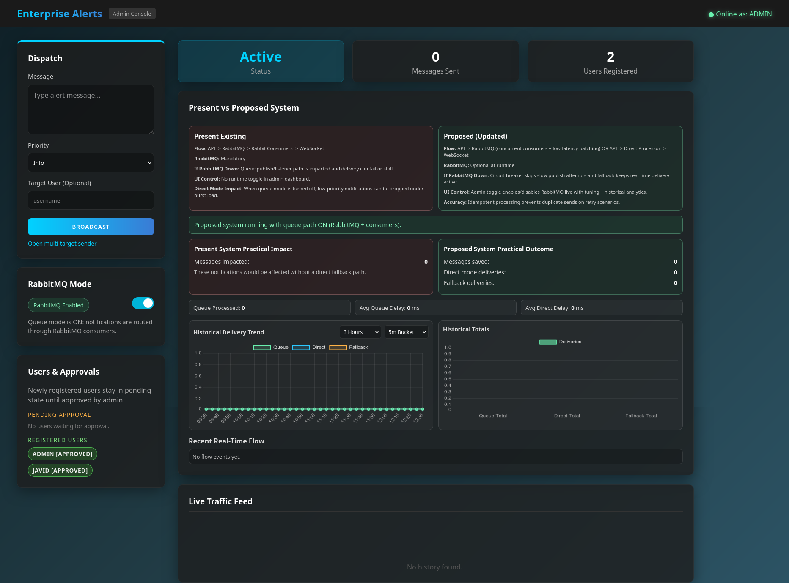
  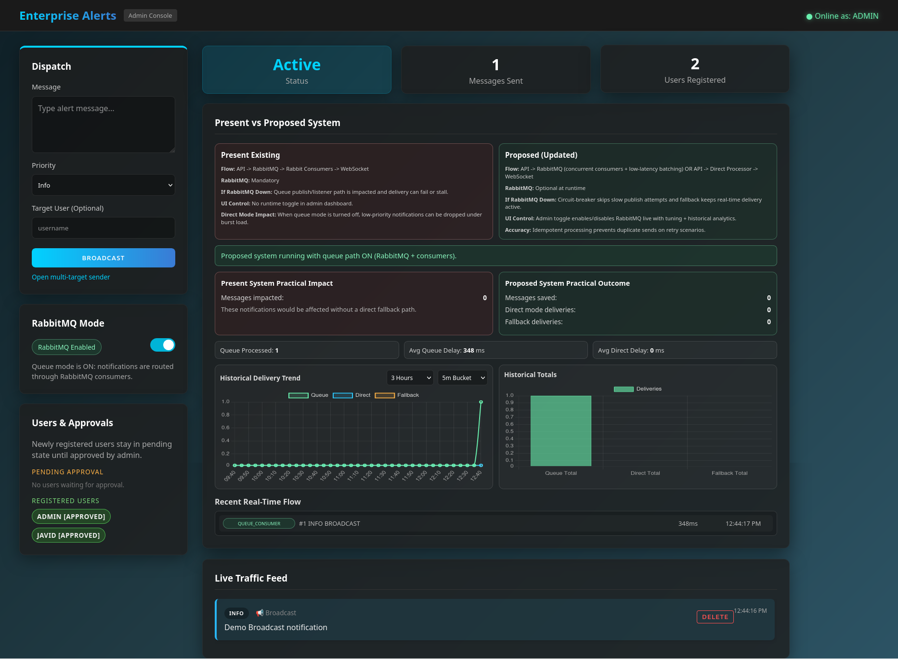
</p>
<p align="center"><em>Dashboard overview with queue mode enabled | First broadcast processed through the queue consumer</em></p>

<p align="center">
  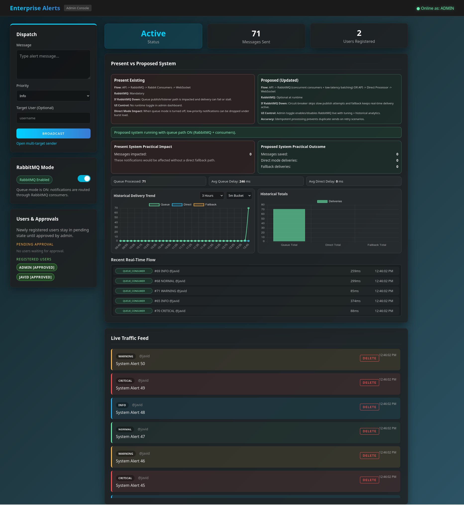
  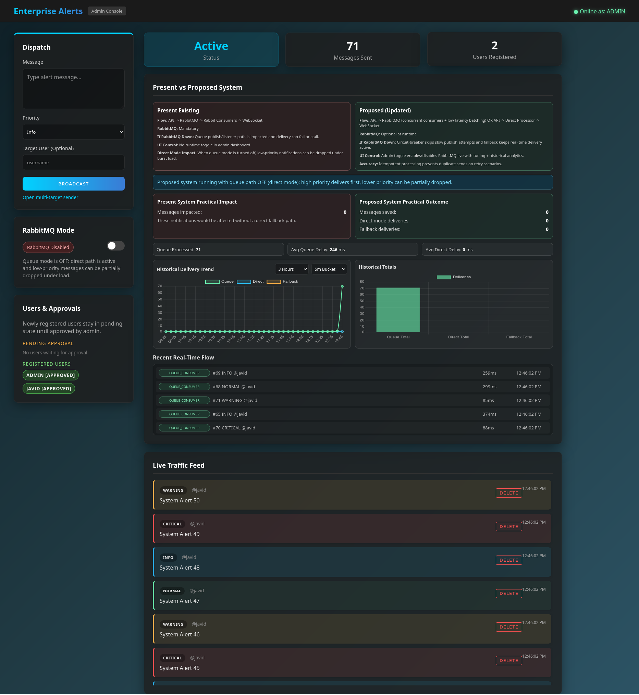
</p>
<p align="center"><em>Queue-mode analytics after a high-volume run | RabbitMQ disabled to compare queue-off runtime behavior</em></p>

<p align="center">
  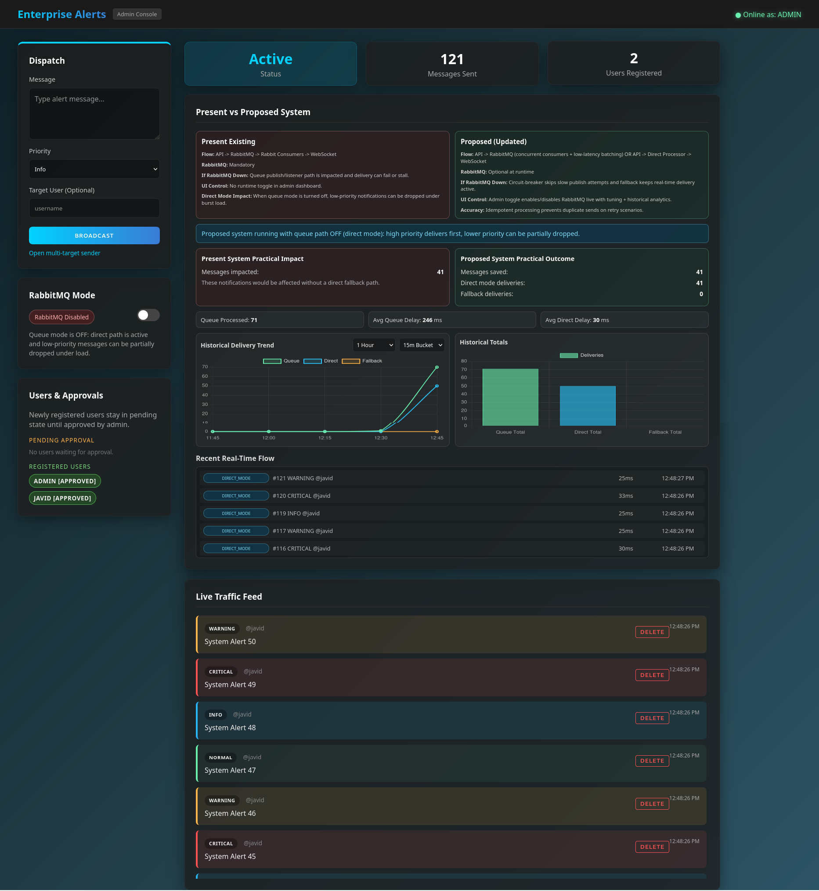
</p>
<p align="center"><em>Direct-mode delivery metrics showing saved traffic after queue mode is switched off</em></p>

### User Portal

<p align="center">
  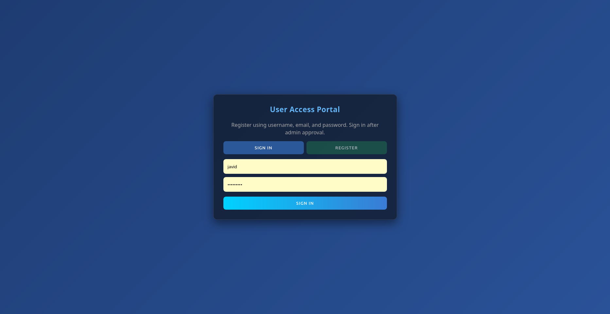
  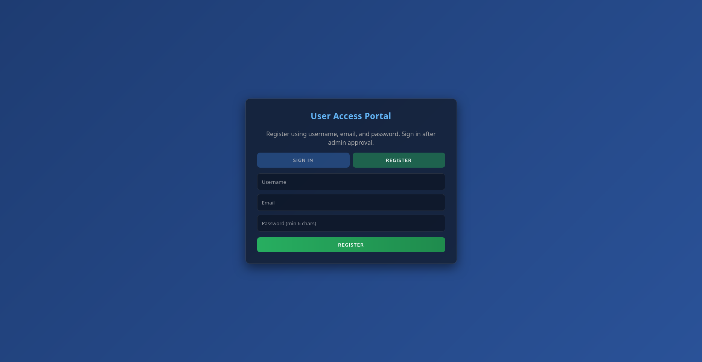
</p>
<p align="center"><em>User sign-in screen | Registration screen for new users awaiting admin approval</em></p>

<p align="center">
  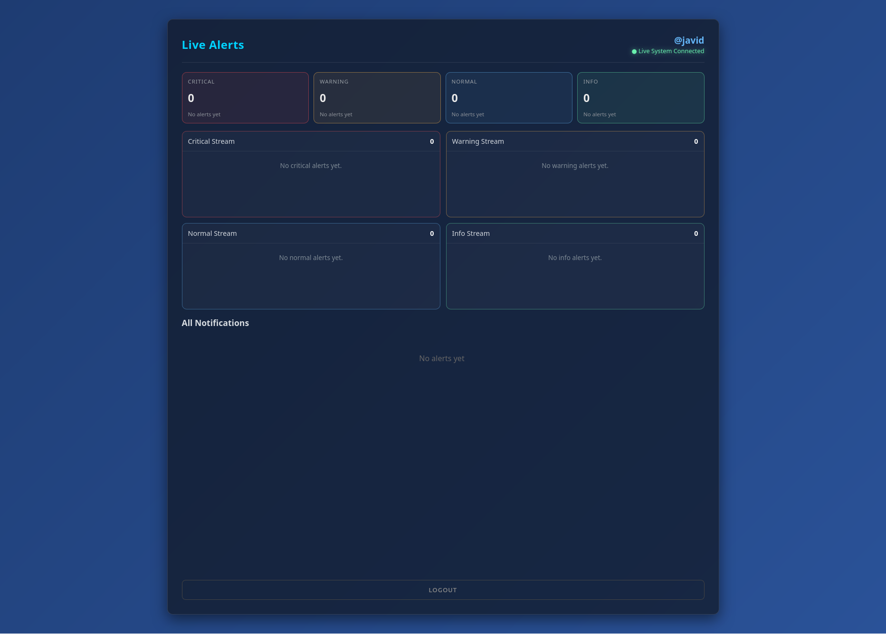
  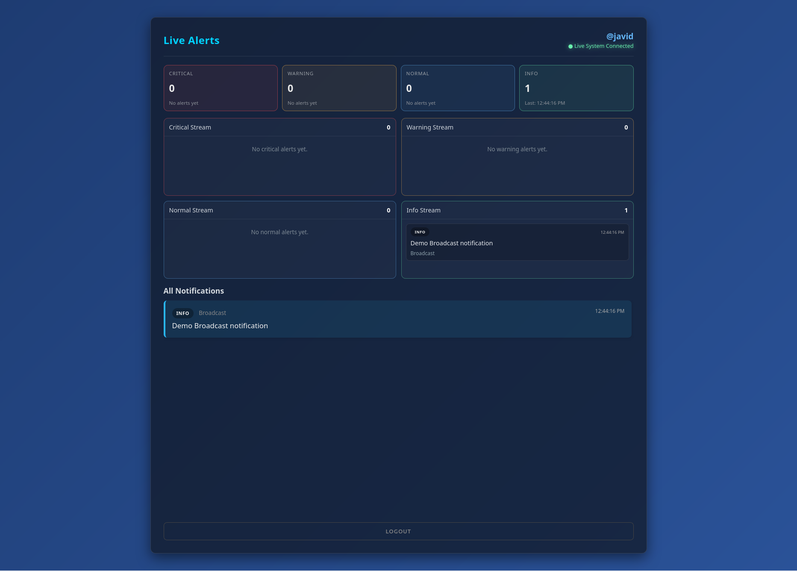
</p>
<p align="center"><em>Empty user dashboard after login | First live alert received and grouped by priority stream</em></p>

<p align="center">
  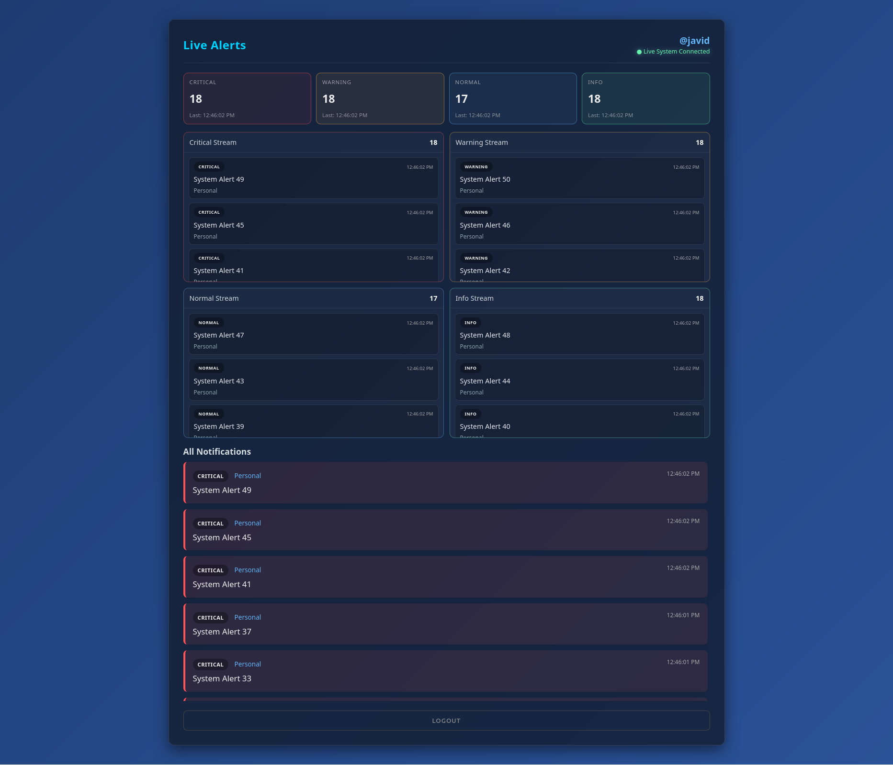
  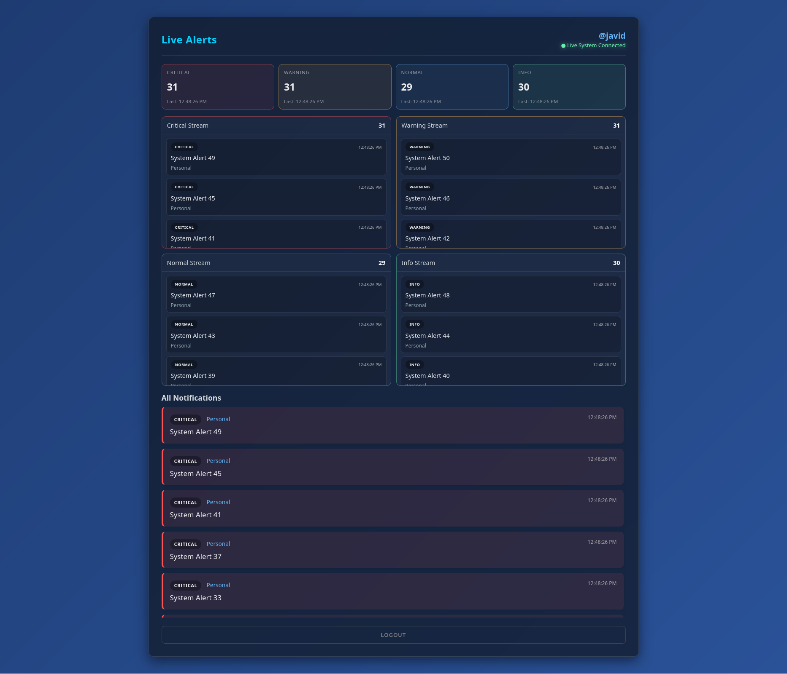
</p>
<p align="center"><em>Priority-sorted personal notification feed | Higher-volume user feed after bulk delivery</em></p>

### Multi-Target Sender

<p align="center">
  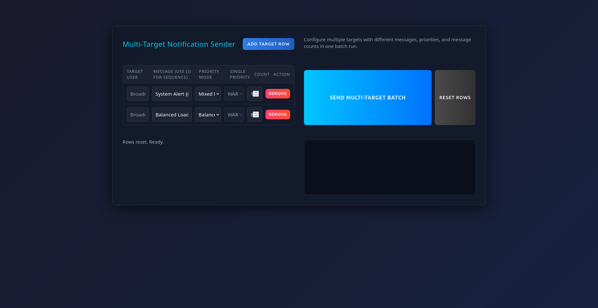
  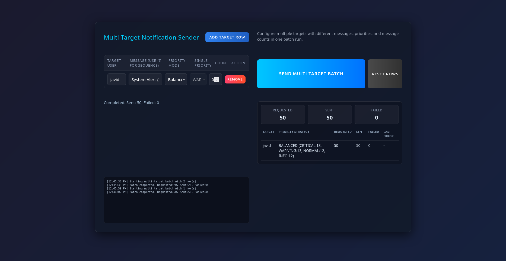
</p>
<p align="center"><em>Multi-target sender with configurable rows and priority modes | Completed batch run with per-target summary and execution log</em></p>

<p align="center">
  
</p>
<p align="center"><em>Balanced batch delivery result for a targeted user</em></p>

## Troubleshooting

### Application cannot connect to MySQL

- Make sure `docker compose up -d` completed successfully.
- Verify MySQL is listening on `localhost:3306`.
- Check that `application.properties` matches the local database credentials.

### RabbitMQ toggle is on, but no queue delivery is happening

- Confirm RabbitMQ is running on `localhost:5672`.
- Open `http://localhost:15672` and verify the broker is healthy.
- If the broker was unavailable recently, wait for the circuit breaker probe to recover it.

### User can register but cannot sign in

- Pending users must be approved from the admin dashboard or via `PUT /api/users/{id}/approve`.

### UI opens, but live updates do not appear

- Confirm the backend is running on `http://localhost:8080`.
- Check the browser console for `/ws` or STOMP connection failures.
- Make sure the user has signed in and the page remains connected to the WebSocket endpoint.
