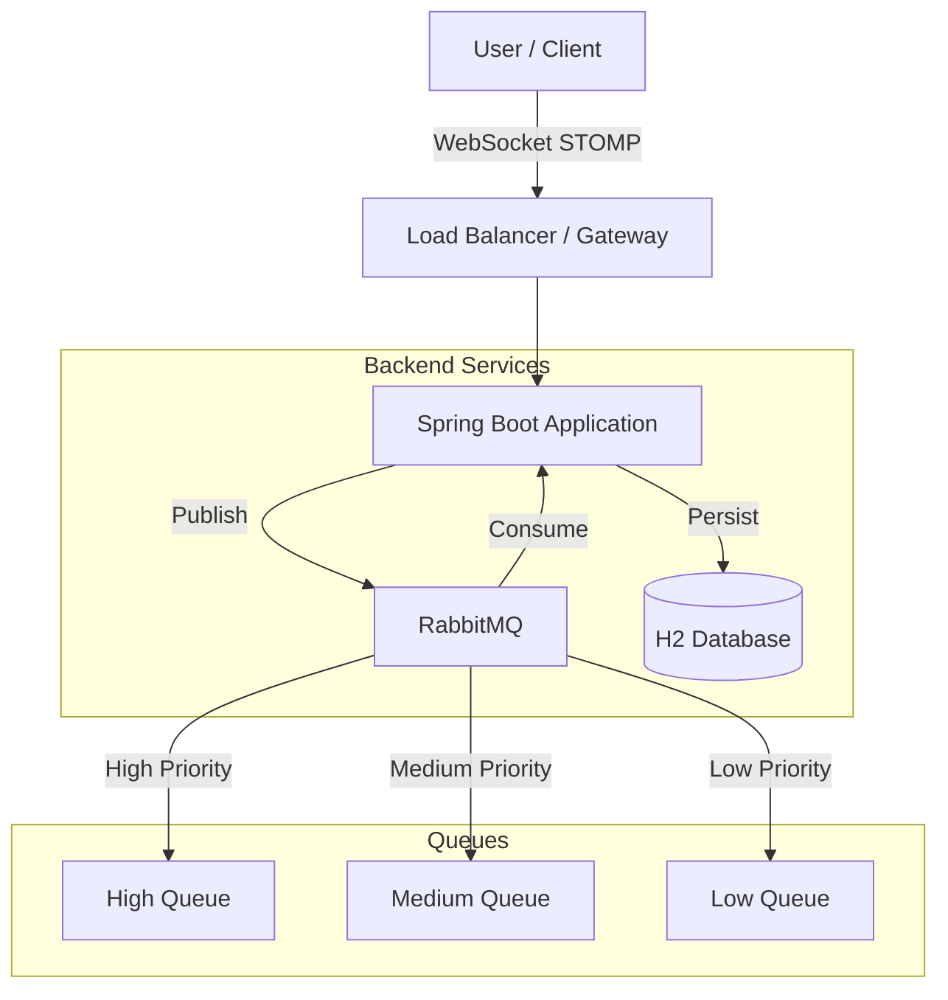

# Real-Time Notification & Alert System

A robust, enterprise-grade real-time notification system built with **Java Spring Boot**, **WebSockets**, **RabbitMQ**, and modern web technologies. This system efficiently delivers critical updates to users through both broadcast and targeted messaging, with features like rate limiting, priority queuing, and persistent storage.

---

## Quick Start (Beginner Friendly)

Follow these steps to get the project running in under 5 minutes.

### 1. Prerequisites
Make sure you have these installed on your computer:
- **Java 17+** (to run the backend)
- **Maven** (to build the project)
- **Docker** (Recommended for RabbitMQ) OR manual RabbitMQ installation
- **Python 3** (to run the frontend)

### 2. Start RabbitMQ (The Message Broker)
The easiest way is using Docker. Open a terminal in the project folder and run:

```bash
docker-compose up -d
```
*This starts a RabbitMQ server in the background on port 5672.*

### 3. Start the Backend (The Brain)
Open a new terminal window in the project folder:

**Linux/macOS:**
```bash
./mvnw spring-boot:run
# OR if you have maven installed:
mvn spring-boot:run
```

**Windows:**
```powershell
.\mvnw spring-boot:run
# OR
mvn spring-boot:run
```

*Wait until you see "Started RealTimeNotificationApplication" in the logs. The backend is now ready at `http://localhost:8080`.*

### 4. Start the Frontend (The User Interface)
Open a **new** terminal window and navigate to the static files:

**Linux/macOS:**
```bash
cd src/main/resources/static
python3 -m http.server 8081
```

**Windows:**
```powershell
cd src\main\resources\static
python -m http.server 8081
```

*You can now access the User Portal at `http://localhost:8081/user.html`.*

---

## Features

### Core Functionality
- **Real-Time Messaging**: WebSocket-based instant notification delivery using STOMP protocol.
- **Dual Delivery Modes**: 
  - **Broadcast**: Send alerts to all connected users.
  - **Targeted**: Send personalized notifications to specific users.
- **Priority Queue System**: HIGH, MEDIUM, LOW priority routing via RabbitMQ.
- **Rate Limiting**: Prevents spam with configurable limits (5 messages/minute per user).
- **Message Deduplication**: Prevents duplicate notifications within a 60-second window.
- **Persistent Storage**: All notifications stored in H2 database with full history.

### Admin Dashboard
- **Live Statistics**: Real-time counts of users and notifications.
- **Notification Management**: View complete history and delete old notifications.
- **User Management**: Create and manage user accounts.
- **Live Traffic Feed**: Monitor all notifications as they're sent.
- **Modern UI**: Glassmorphism design with dark theme and animated gradients.

### User Portal
- **Authentication**: Username-based login with validation.
- **Notification History**: View all past notifications (personal + broadcasts).
- **Real-Time Updates**: Instant delivery of new notifications via WebSocket.
- **Visual Distinction**: Clear indicators for personal vs. broadcast messages.
- **Responsive Design**: Works seamlessly on desktop and mobile.

---

## Architecture



---

## System Design Diagrams

<div align="center">

### Architecture Diagram


<!--  -->


</div>

---

## Detailed Installation & Setup

If you need more control or are setting up for development, follow these detailed steps.

### 1. Verification
Ensure RabbitMQ is running:
- **Docker**: `docker ps` should show `rabbitmq` container.
- **Manual**: Access `http://localhost:15672` (guest/guest).

### 2. Build the Project
```bash
mvn clean install
```

### 3. Run Stress Tests (Optional)
To test high-volume traffic, start the **Bulk Sender** tool:

```bash
# In src/main/resources/static
python3 -m http.server 8082
```
Access at **http://localhost:8082/bulk_sender.html**.

---

## Accessing the Application

| Component | URL | Description |
|-----------|-----|-------------|
| **Admin Dashboard** | [http://localhost:8080/index.html](http://localhost:8080/index.html) | Send notifications, manage users, view stats. |
| **User Portal** | [http://localhost:8081/user.html](http://localhost:8081/user.html) | Login as a user to receive alerts. |
| **Bulk Sender** | [http://localhost:8082/bulk_sender.html](http://localhost:8082/bulk_sender.html) | Stress test the system. |
| **H2 Console** | [http://localhost:8080/h2-console](http://localhost:8080/h2-console) | DB Access (JDBC URL: `jdbc:h2:mem:notification_db`). |

---

## API Documentation

### Notification Endpoints

#### Send Notification
`POST /api/notifications/send`
```json
{
  "message": "System maintenance at 2 AM",
  "priority": "HIGH",
  "username": "javid"  // Optional: omit for broadcast
}
```

#### Get All Notifications
`GET /api/notifications`

#### Get User Notifications
`GET /api/notifications/user/{username}`

#### Dashboard Stats
`GET /api/notifications/stats`

---

## Troubleshooting

### Common Issues

**1. "Connection Refused" usually means a service isn't running.**
- If `localhost:8080` fails -> Start Spring Boot.
- If `localhost:5672` fails -> Start RabbitMQ (`docker-compose up`).

**2. Port 8080 Already in Use**
- Find the process: `lsof -i :8080` (Linux/Mac) or `netstat -ano | findstr :8080` (Windows).
- Kill it and try again.

**3. WebSocket Connection Failed**
- Check browser console (F12).
- Ensure your firewall isn't blocking WebSocket connections.

---

## Application Output & Screenshots

<div align="center">

### Admin Dashboard Overview


### Targeted Messaging


### User Management


### User Management


### Bulk Notification Dashboard


### Rate Limiting


### Bulk Notification Handling


</div>
